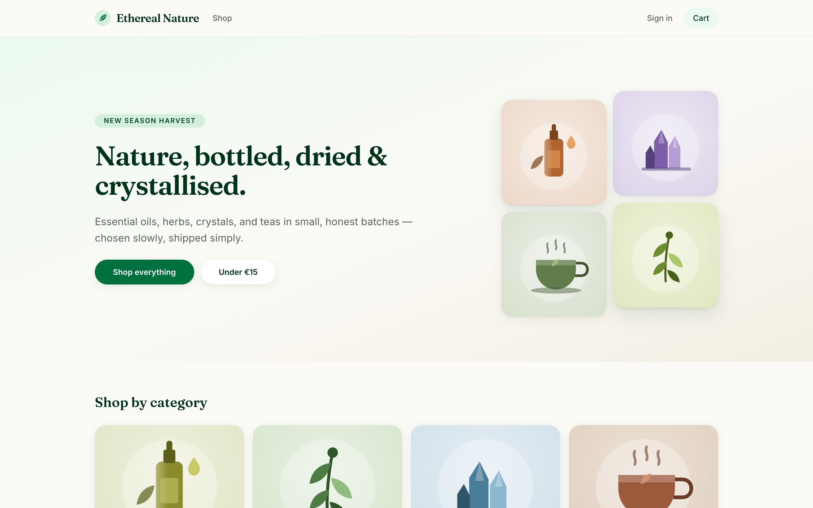
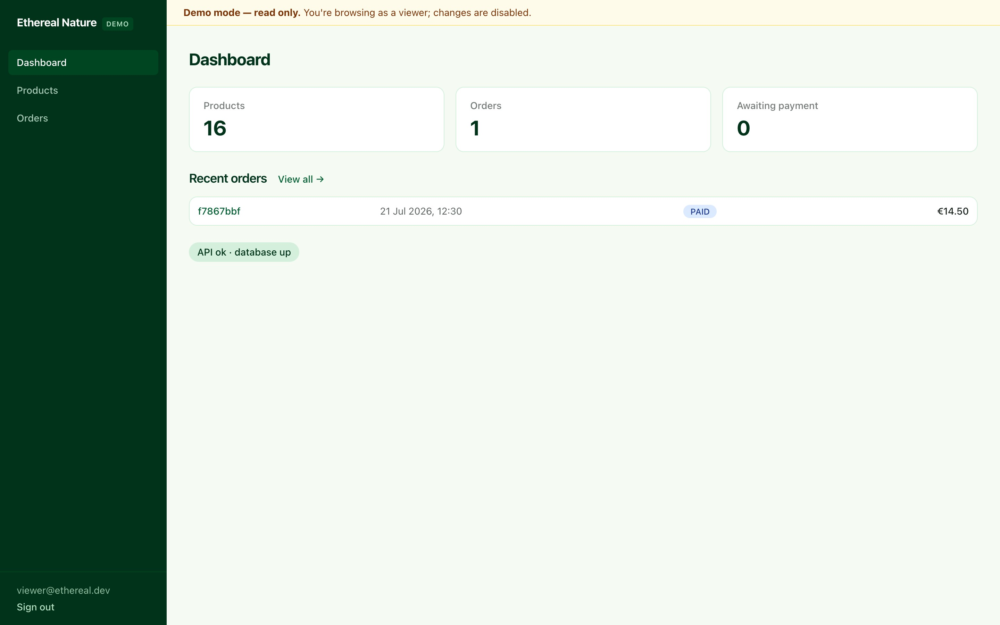
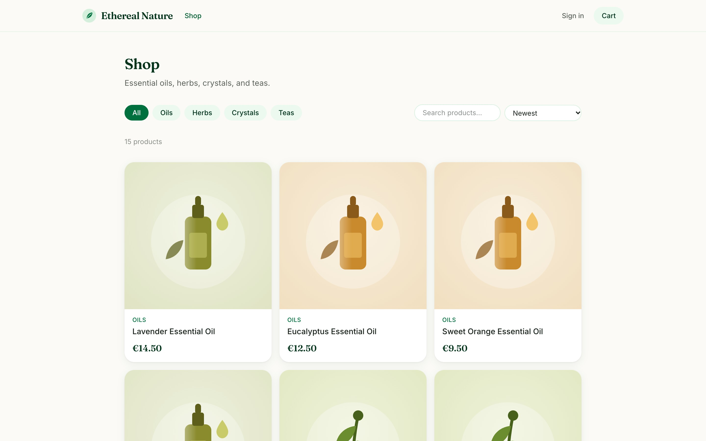
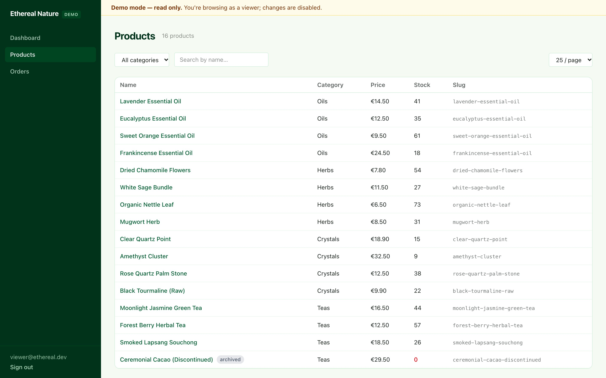
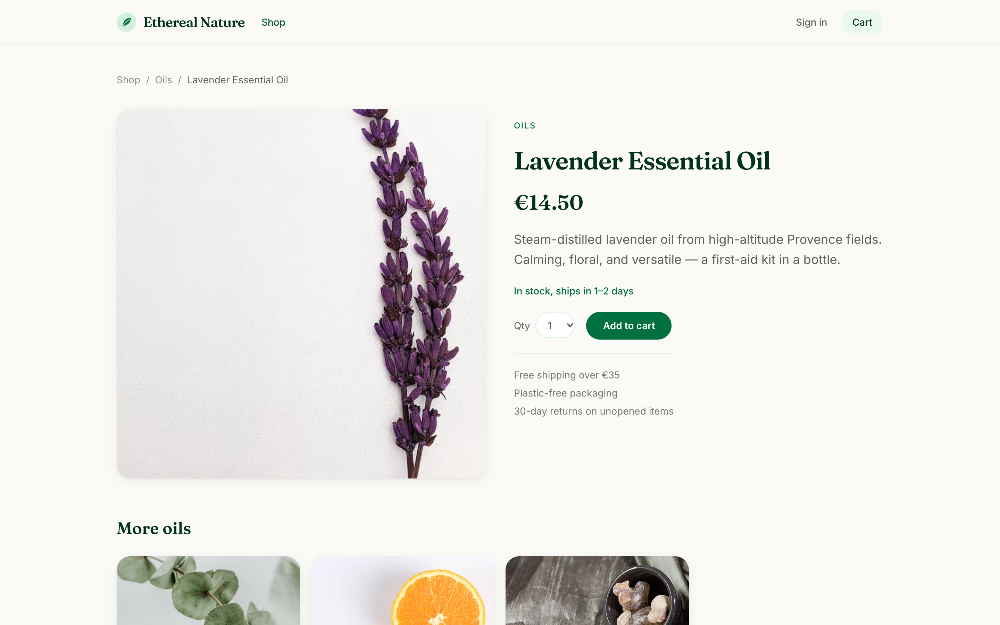
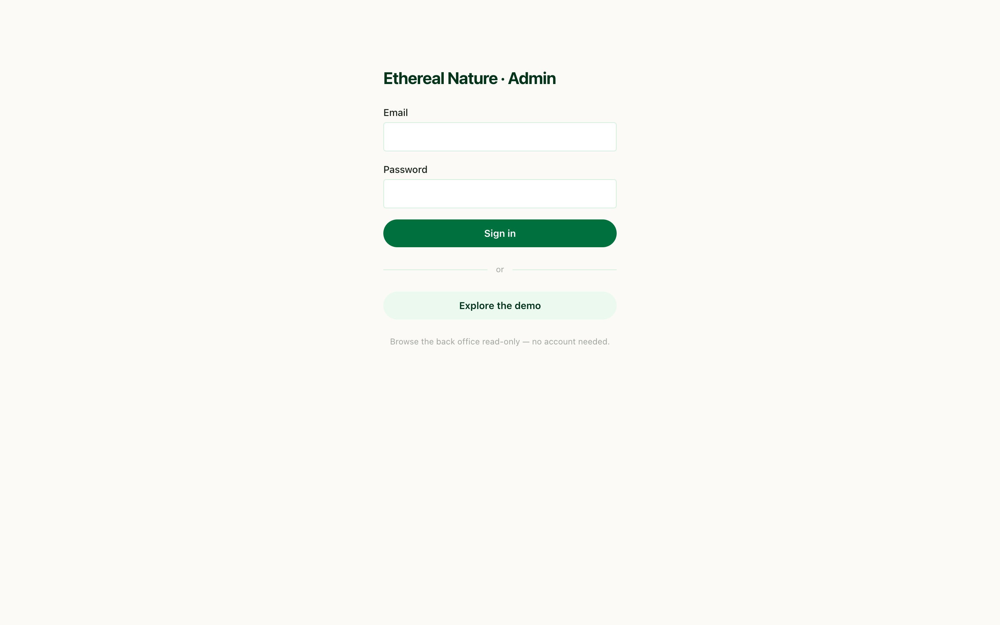
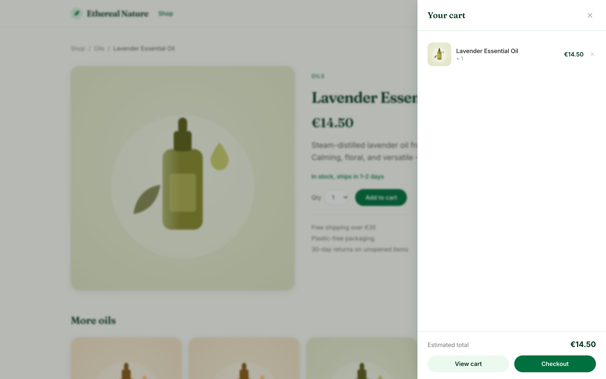

# ethereal_nature

A small e-shop built to demonstrate clean, scalable architecture — not feature
breadth. The domain is intentionally shallow (catalog, cart, ordering,
identity, payments); the structure around it is the point.

**Live demo:** [eth-nature.terzidest.com](https://eth-nature.terzidest.com) ·
[back office](https://eth-nature-admin.terzidest.com) (one-click read-only
demo — no account needed). Checkout runs a mock payment provider end to end;
no real money anywhere.

## Screenshots

| Storefront | Back office |
|---|---|
|  |  |
|  |  |
|  |  |
|  | |

## Stack

- **Monorepo:** pnpm + Turborepo, one TypeScript workspace end to end,
  joined to the backend only by the API contract.
- **Frontends:** TanStack Start (storefront + admin), TanStack Router, React
  Query, Zustand, Tailwind + headless primitives + TanStack Table.
- **Backend:** Fastify + TypeScript, Kysely (typed SQL), Postgres —
  originally built in Kotlin/Ktor and migrated behind the frozen OpenAPI
  contract with a byte-identical regenerated client and zero frontend
  changes ([ADR-0010](docs/adr/0010-fastify-migration-behind-frozen-contract.md),
  Kotlin preserved at the `kotlin-final` tag).
- **Contract:** OpenAPI → generated `packages/api-client`.

## Layout

```
apps/storefront    public SSR/prerender store
apps/admin         authenticated SPA dashboard
apps/server        Fastify, bounded contexts
packages/api-client  generated types + React Query hooks
packages/ui          shared Tailwind components + tokens
packages/config      shared lint/ts/tailwind presets
docs/adr             decision records
```

## Read next

- **[ARCHITECTURE.md](ARCHITECTURE.md)** — canonical reference: contract, FE/BE
  structure, bounded contexts, the cart→login→order flow.
- **[ROADMAP.md](ROADMAP.md)** — phased, exitable build plan (contract-first,
  read paths before write paths).
- **[CLAUDE.md](CLAUDE.md)** — operating rules and hard invariants for agents.
- Per-app agent guardrails:
  [storefront](apps/storefront/CLAUDE.md) ·
  [admin](apps/admin/CLAUDE.md) ·
  [backend](apps/backend/CLAUDE.md).
- **[docs/adr/](docs/adr/README.md)** — why each decision was made.

## The one rule worth memorising

The server never trusts a client-supplied price, total, or stock. The client
cart is a list of intents; the backend is the source of truth for money and
availability — always recomputed at merge and at checkout.
